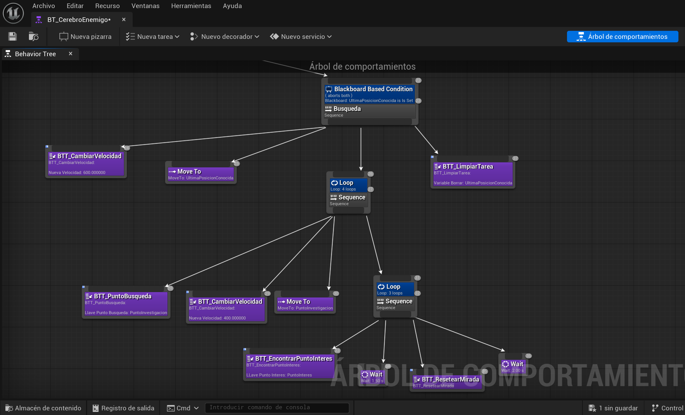
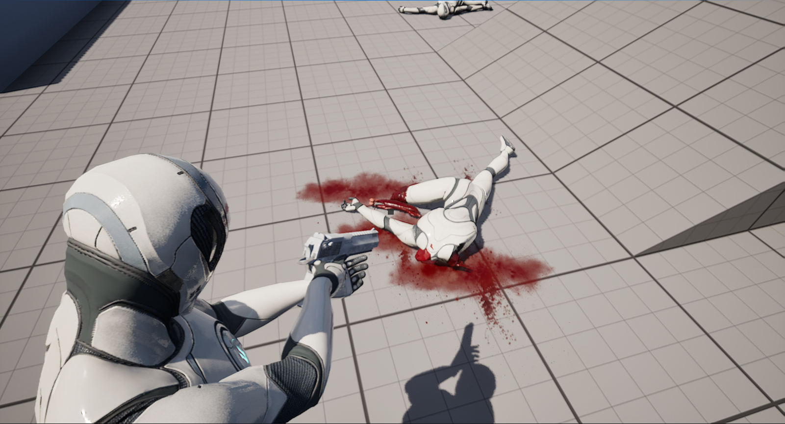
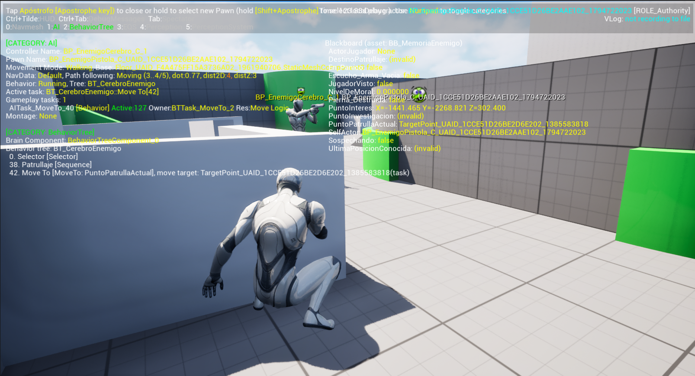
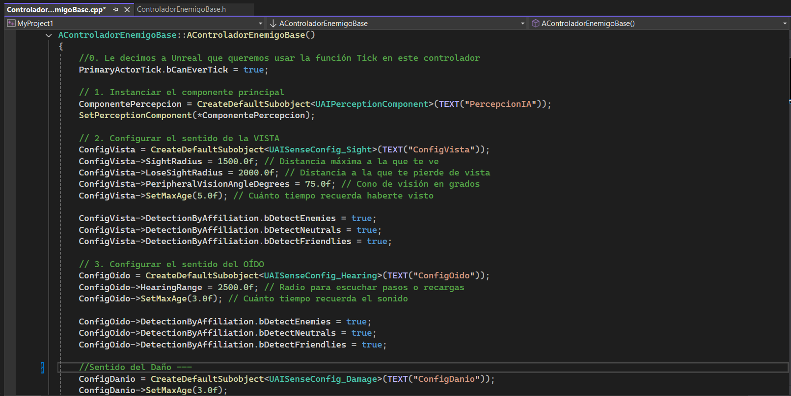

# UE5 Tactical AI Combat Demo

Demo técnica en **Unreal Engine 5 y C++** de combate en tercera persona: enemigos con IA táctica (percepción, memoria y toma de decisiones), balística hitscan, daño localizado y físicas reactivas con Chaos.

📺 **[Ver demostración en YouTube](https://youtu.be/H3Aa7519PL4)** &nbsp;|&nbsp; 📖 **[Ver documentación en el portafolio](https://alej673.github.io/proyecto-ue5.html)**

El proyecto separa las mecánicas base (C++ y Blueprints) de la parte visual para mantener el rendimiento y facilitar su ampliación. Está optimizado para una PC de gama media (RTX 4050, 6 GB de VRAM).

---

## Contexto y reto

El objetivo fue construir un entorno de simulación táctica (graybox) que fuera más allá de las lógicas prefabricadas del motor. El reto principal fue desarrollar una IA capaz de **percibir y recordar al jugador**, acoplada a un sistema de combate donde el impacto y la movilidad respondan a cálculos matemáticos y no a animaciones lineales.

**Solución:** una arquitectura modular con tres pilares:

1. **Jugador con mecánicas procedurales:** Aim Sway, parkour y cobertura.
2. **Motor físico dinámico con Chaos:** desmembramiento y ragdolls optimizados.
3. **"Cerebro híbrido" para los NPCs:** C++ procesa los estímulos sensoriales y los Behavior Trees ejecutan la toma de decisiones.

---

## Stack tecnológico

| Área | Tecnología |
|------|------------|
| Motor | Unreal Engine 5 |
| Lógica de gameplay | C++ (AI Controllers, `UAIPerceptionComponent`) |
| Scripting visual | Blueprints, Behavior Trees, Blackboards, AnimGraphs |
| Físicas y destrucción | Chaos Physics (ragdolls, desmembramiento procedural) |
| Efectos visuales | Niagara, DBuffer Decals |
| Entorno | NavMesh, Megascans (Quixel) |

---

## Decisiones arquitectónicas clave

### Arquitectura híbrida de IA (C++ / Blueprints)
El procesamiento sensorial (visión de cono, audición y validación de línea de visión) está en C++ (`ControladorEnemigoBase`, derivado de `AAIController`). Los resultados se escriben en tiempo real en el Blackboard, y la lógica de navegación (patrullaje, búsqueda, pánico y combate) la ejecuta un Behavior Tree modular.

### Balística hitscan y Aim Sway procedural
Se descartaron los proyectiles físicos dependientes del `Tick` a favor de un sistema hitscan con Line Trace. El balanceo del arma y la cámara se calcula en tiempo real con funciones trigonométricas, lo que reemplaza los CameraShakes genéricos y mantiene la precisión al apuntar.

### Sistema de daño localizado data-driven (Chaos)
El desmembramiento y la reacción al impacto son independientes de la vida global del NPC. Un diccionario de datos (`Map`) ensambla las extremidades mutiladas en tiempo de ejecución. Para proteger la CPU, una rutina post-mortem pone los Rigid Bodies en estado *Sleep* a los 4 segundos.

### Locomoción y cobertura dinámica
La máquina de estados manipula la cápsula de colisión (`Crouch` / `Uncrouch`) según Raycasting espacial. Esto permite transiciones de cobertura (asomarse desde la cobertura) y vaulting/mantle modular con curvas Timeline, sin romper las físicas del motor.

---

## Módulos principales

| Módulo | Responsabilidad |
|--------|-----------------|
| Núcleo de percepción (C++) | Distingue visión frontal y periférica (radios de 1.500 a 2.000 unidades), mantiene memoria a corto plazo (última posición conocida) y filtra estímulos por tags. |
| Gunplay y armamento | Jerarquía de armas extensible (`BP_ArmaBase`), cadencia con temporizadores, retroceso aditivo y recargas asíncronas sin condiciones de carrera. |
| Feedback volumétrico | Sangre proyectada con Decals confinados a canales específicos (`Sangre_Entorno`) para evitar Z-Fighting y proyecciones sobre entidades móviles. |
| Comportamiento táctico | Seguimiento con `Set Focal Point`, que permite strafe lateral y barrido visual durante el patrullaje. |

---

## Problemas resueltos

- **Errores `Accessed None` por condiciones de carrera:** se movió la activación del Behavior Tree al evento `OnPossess` del controlador.
- **Fuga de memoria en `Event Tick`:** corregida; además, los cuerpos caídos tienen costo de CPU cero gracias a `Rigid Body Sleep`.
- **Colisiones (`Capsule Riding`) y jerarquía esquelética:** resueltas en amputaciones sucesivas.

Cada problema y su solución están documentados en el [portafolio](https://alej673.github.io/proyecto-ue5.html).

---

## Capturas

| Behavior Tree | Sistema físico y desmembramiento |
|:---:|:---:|
|  |  |

| Percepción y debugging | AI Controller (C++) |
|:---:|:---:|
|  |  |

---

## Estado del proyecto

- **Estado:** demo técnica funcional (graybox).
- **Completado:** Fase 1 (jugador y matemáticas), Fase 2 (físicas y game feel) y Fase 3 (IA, módulo A).
- **En desarrollo:** Fase B (EQS, coberturas y flanqueo).
- **Documentación:** más de 30 páginas de bitácora técnica en el [portafolio](https://alej673.github.io/proyecto-ue5.html).

---

## Estructura del repositorio

| Carpeta | Contenido |
|---------|-----------|
| `Source/` | Código C++ (controladores de IA, percepción, armas). |
| `Content/` | Blueprints, Behavior Trees, Blackboards, VFX y assets. |
| `Config/` | Configuración del proyecto. |

---

## Instalación local

**Requisitos:** Windows 64 bits, Unreal Engine 5.x y Visual Studio 2022 con la carga de trabajo *Desarrollo de juegos con C++*.

```bash
# 1. Clonar el repositorio
git clone https://github.com/Alej673/UE5-Tactical-AI-Combat-Demo.git
cd UE5-Tactical-AI-Combat-Demo
```

2. Clic derecho en `MyProject1.uproject` → **Generate Visual Studio project files**.
3. Abrir `MyProject1.sln` en Visual Studio 2022 y compilar (*Development Editor* / *Win64*).
4. Abrir el proyecto con doble clic en `MyProject1.uproject`.

---

**Autor:** Alejandro Larco  
[GitHub](https://github.com/Alej673) · [LinkedIn](https://www.linkedin.com/in/alejandro-larco-03297b42a) · [Portafolio](https://alej673.github.io)
